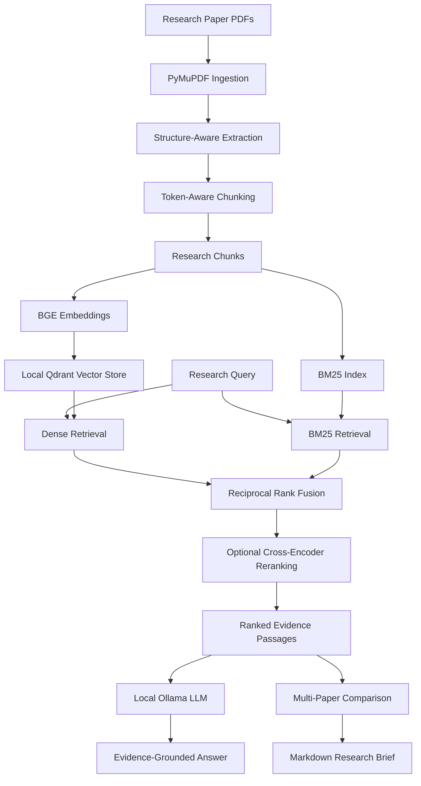

# AI Research Engine

A locally runnable, evidence-grounded research assistant that retrieves, compares, and synthesizes information across scientific papers.

The system combines semantic vector retrieval with BM25 lexical search, fuses their rankings using Reciprocal Rank Fusion (RRF), and uses a local language model to generate answers grounded in retrieved passages.

## Features

- PDF ingestion using PyMuPDF.
- Structure-aware, token-aware document chunking.
- Semantic embeddings using BAAI/bge-base-en-v1.5.
- Local vector search using Qdrant.
- Lexical retrieval using BM25.
- Hybrid retrieval using Reciprocal Rank Fusion.
- Optional BGE cross-encoder reranking.
- Evidence-grounded question answering using a local Ollama model.
- Multi-paper research comparison.
- Markdown research brief export.
- Interactive Streamlit interface.

## Architecture


## Technology Stack

| Component | Technology |
|---|---|
| Language | Python |
| PDF Processing | PyMuPDF |
| Embedding Model | BAAI/bge-base-en-v1.5 |
| Embedding Framework | Sentence Transformers |
| Vector Database | Qdrant |
| Lexical Retrieval | BM25 |
| Hybrid Fusion | Reciprocal Rank Fusion |
| Optional Reranker | BAAI/bge-reranker-base |
| Local LLM | Qwen3 4B Instruct |
| LLM Runtime | Ollama |
| Interface | Streamlit |
| Testing | pytest |

## Project Structure

```text
ai-research-engine/
├── data/
│   ├── papers/
│   ├── evaluation_questions.json
│   └── qdrant/
├── reports/
│   └── retrieval_benchmark.json
├── src/
│   ├── app.py
│   ├── ingestion.py
│   ├── embeddings.py
│   ├── vector_store.py
│   ├── index_corpus.py
│   ├── retrieval.py
│   ├── bm25.py
│   ├── hybrid.py
│   ├── hybrid_retrieval.py
│   ├── reranker.py
│   ├── answer.py
│   ├── generation.py
│   ├── comparison.py
│   ├── research_brief.py
│   ├── evaluate_retrieval.py
│   └── test_*.py
├── requirements.txt
└── README.md
```

## Installation and Setup

### Prerequisites

- Python 3.11 or newer
- Ollama
- Git
- Internet connection for initial model downloads

Apple Silicon Macs can use Apple's Metal Performance Shaders (MPS) backend through PyTorch when available. The project automatically selects MPS or CPU.

### 1. Clone the repository

```bash
git clone https://github.com/utsav220506/ai-reasearch-engine.git
cd ai-reasearch-engine
```

The clone URL above is the repository configured as this checkout's `origin`.

### 2. Create a virtual environment

```bash
python3 -m venv venv
source venv/bin/activate
```

### 3. Install dependencies

```bash
python -m pip install --upgrade pip
pip install -r requirements.txt
```

### 4. Install Ollama and download the language model

Install Ollama from https://ollama.com/

Then run:

```bash
ollama pull qwen3:4b-instruct
ollama list
```

### 5. Add research papers

Place PDF files inside:

```text
data/papers/
```

The indexer reads PDFs from this directory. PDFs placed directly inside `data/` are not included.

### 6. Build the research index

```bash
PYTHONPATH=src python src/index_corpus.py
```

This extracts the research papers, creates chunks, generates embeddings, and stores the vectors in the local Qdrant database.

The first run downloads the embedding model if it is not already cached.

## Running the Application

Activate the virtual environment and run:

```bash
source venv/bin/activate
PYTHONPATH=src streamlit run src/app.py
```

The Streamlit interface provides three workflows.

### Research Q&A

Ask questions across the indexed research corpus. The system retrieves relevant passages and generates answers with evidence identifiers and source metadata.

### Paper Comparison

Select between two and five papers, provide a research question, and retrieve evidence independently from each selected paper.

The system generates a structured comparison covering findings, methods, results, agreements, differences, and limitations. The result can be exported as a Markdown research brief.

### Paper Library

Upload additional PDF papers through the interface. New papers are saved and indexed alongside the existing corpus.

## Retrieval Pipeline

### 1. Dense Retrieval

Research passages and user queries are embedded using `BAAI/bge-base-en-v1.5`.

Qdrant performs semantic vector search to retrieve passages based on embedding similarity.

### 2. BM25 Lexical Retrieval

BM25 ranks passages using lexical relevance. It provides a complementary retrieval signal for exact terminology, technical phrases, and keywords.

### 3. Reciprocal Rank Fusion

The dense and lexical ranked lists are combined using Reciprocal Rank Fusion:

\[
RRF(d) = \sum_{r \in R} \frac{1}{k + rank_r(d)}
\]

Here, `rank_r(d)` represents the rank of document `d` in a retrieval list, and `k` is a smoothing constant.

### 4. Optional Cross-Encoder Reranking

The system supports `BAAI/bge-reranker-base` to score query-passage pairs and reorder retrieved candidates.

The reranker remains optional because it did not improve the current benchmark results.

## Retrieval Evaluation

The benchmark compares four retrieval configurations:

1. Dense retrieval
2. BM25 retrieval
3. Hybrid retrieval using RRF
4. Hybrid RRF followed by cross-encoder reranking

Evaluation metrics include:

- Hit@5
- Recall@5
- Mean Reciprocal Rank (MRR)
- nDCG@5
- Average retrieval latency
- Median retrieval latency

Run the benchmark:

```bash
PYTHONPATH=src python src/evaluate_retrieval.py
```

Detailed results are saved to:

```text
reports/retrieval_benchmark.json
```

### Benchmark Results

The current exploratory evaluation contains 11 questions, 2 research papers, and 78 extracted chunks.

| Retrieval Method | Recall@5 | MRR | nDCG@5 | Average Latency |
|---|---:|---:|---:|---:|
| Dense | 0.6357 | 0.6667 | 0.5502 | 16.67 ms |
| BM25 | 0.6357 | 0.7758 | 0.5996 | 0.12 ms |
| **Hybrid RRF** | **0.6963** | **0.8864** | **0.6964** | **18.80 ms** |
| Hybrid RRF + Reranker | 0.6509 | 0.6061 | 0.5277 | 467.19 ms |

Hybrid RRF achieved the strongest Recall@5, MRR, and nDCG@5 in this evaluation.

The reranker did not improve ranking metrics and introduced substantially higher latency. It therefore remains optional.

**Evaluation limitations:** These results represent an initial engineering benchmark, not proof of general retrieval superiority. The evaluation set is small, covers only two papers, and uses manually assigned relevance labels. Results may change with a larger and more diverse corpus.

Latency measurements are specific to the development environment and should not be interpreted as hardware-independent performance guarantees.

## Testing

Run the automated test suite:

```bash
PYTHONPATH=src python -m pytest -q
```

The tests cover hybrid rank fusion, generation validation, citation handling, and research brief generation.

## Design Considerations

- Retrieval is performed locally using Qdrant and BM25.
- Language generation runs locally through Ollama.
- Retrieved evidence is supplied to the generation layer with evidence identifiers.
- Generated citations are checked against the supplied evidence identifiers.
- Supporting passages and source metadata are available for inspection.
- The reranker remains optional based on current evaluation results.

Citation validation checks whether cited evidence identifiers exist in the retrieved evidence set. It does not establish formal semantic entailment between every generated claim and its cited passage.

## Future Improvements

- Expand the evaluation dataset with more research papers and independently reviewed relevance labels.
- Evaluate retrieval across additional research domains and query types.
- Improve citation-level claim verification.
- Improve document metadata extraction.
- Evaluate retrieval quality and latency on larger corpora.
- Explore query expansion and alternative fusion strategies.

## License

This project is distributed under the MIT License; see [LICENSE](LICENSE). Research papers added to the local library and pretrained models retain their own licenses and terms.
